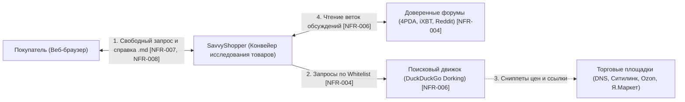
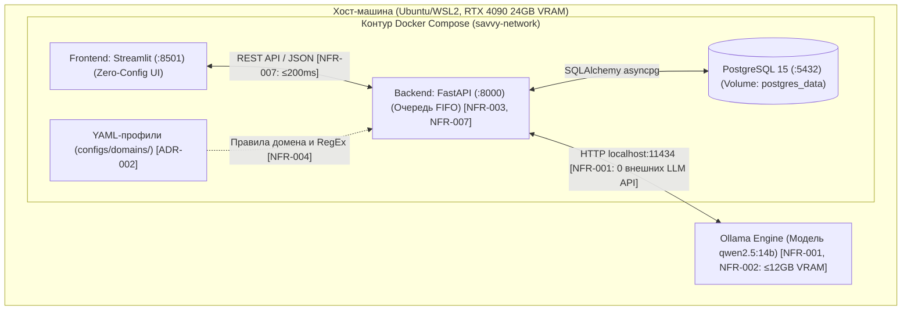
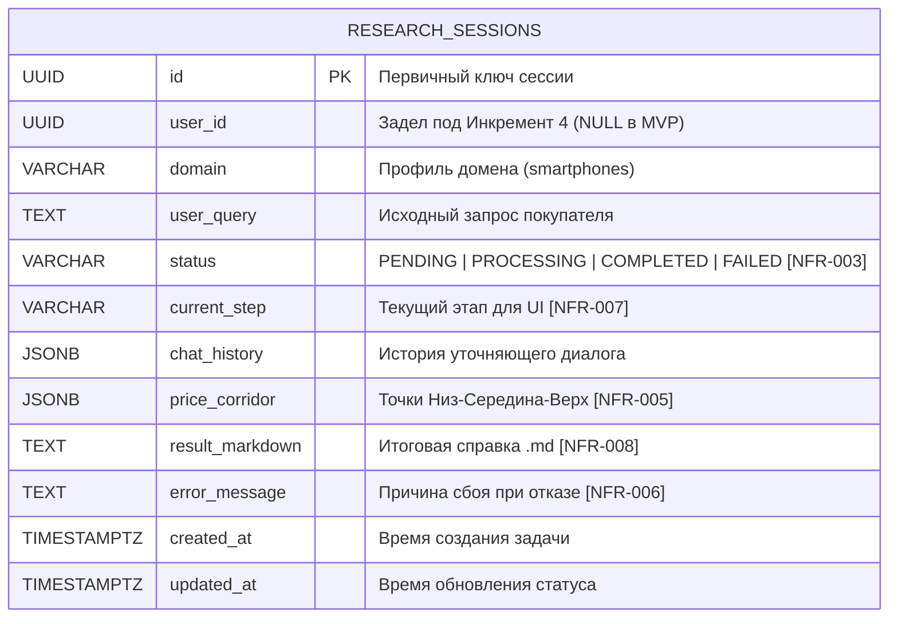
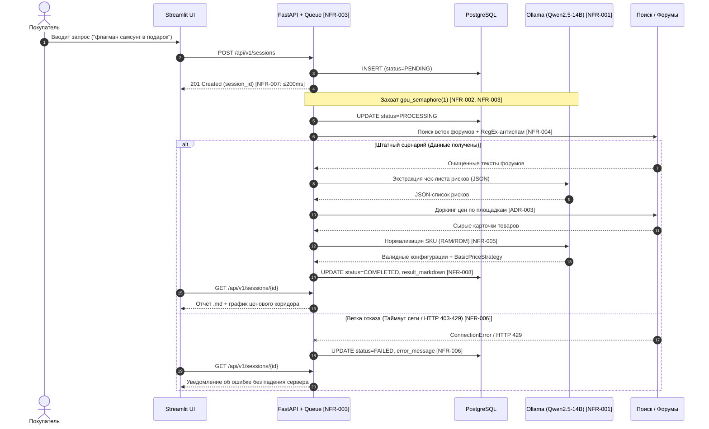

# Архитектура системы SavvyShopper (КТ-2)
**Дата актуализации:** 24.11.2026  
**Статус:** Утверждено для КТ-2

---

## 1. Контекстная диаграмма (C4 Context)
Описывает границы системы и взаимодействие с внешним окружением.

---

## 2. Диаграмма контейнеров и развёртывания (C4 Containers & Deployment)
Описывает распределение сервисов по Docker-контейнерам и взаимодействие с локальным GPU.

---

## 3. Модель данных (ER-диаграмма)
Описывает структуру единственной таблицы MVP с архитектурным заделом под авторизацию (Инкремент 4).

---

## 4. Последовательность ключевого сценария и ветки отказа (Sequence Diagram)
Описывает штатное прохождение запроса по конвейеру и обработку сетевого сбоя.

---

## 5. Легенда и привязка к требованиям
* **Сплошные стрелки (`-->`):** Синхронные и асинхронные потоки передачи данных и управления.
* **Пунктирные стрелки (`-.->`):** Загрузка декларативных правил конфигурации (`configs/domains/*.yaml`).
* **Блоки `alt / else`:** Ветвление алгоритма при штатной работе и при сбоях внешнего окружения.
* **Теги `[NFR-XXX]`:** Явная трассировка архитектурных ограничений на реестр нефункциональных требований (`docs/requirements/nfr.md`).
